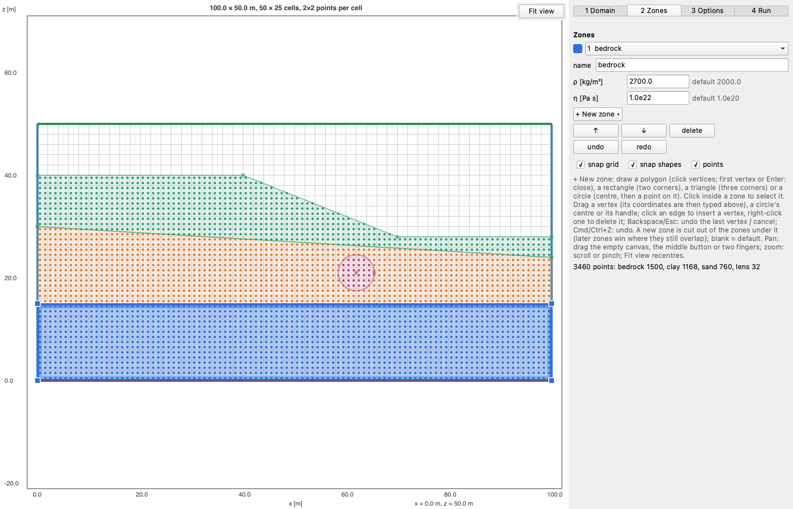

# EasyDraw.jl

[](https://ewyser.github.io/EasyDraw.jl/dev/)
[](https://github.com/ewyser/EasyDraw.jl/actions/workflows/CI.yml?query=branch%3Amain)

EasyDraw lets you draw the zones of a 2D (x–z) model, by hand on a domain or over a scanned cross-section, and get
them back as data for your solver:

- **Finite differences, particles:** the zone or a property at any coordinates, e.g. on your grid.
- **Finite elements:** disjoint regions with shared edges, written as a Gmsh script.

The same zones can be written in code instead of drawn. A point belongs to the **last** zone that contains it, so a
zone drawn later overrides the ones below it.



## Install

EasyDraw is not registered yet:

```julia
] add https://github.com/ewyser/EasyDraw.jl
```

This installs the window too (Qt Quick, through QML.jl). `using EasyDraw` itself is instant: Qt loads with the first
window of a session, which takes about 20 s (the next ones open at once). Julia 1.10 or later.

## A first model

Draw it:

```julia
using EasyDraw
l = draw()                          # a new domain; returns a Layout, or nothing if cancelled
```

or write it:

```julia
l = Layout(; L=[100.0, 50.0], nel=[50, 25],                     # [0, 100] × [0, 50] m, 50 × 25 cells
             zones=[Zone("mantle", Block([0, 0], [100, 40]); rho=3300.0, eta=1e21),
                    Zone("plume",  Ball([50, 15], 8.0);       rho=3200.0, eta=1e19)])
save_layout("plume_layout.toml", l)
l = draw("plume_layout.toml")       # and edit it in the window
```

then use it:

```julia
rho = property(l, "rho", 1.0:2.0:99.0, 1.0:2.0:49.0)   # on your grid's cell centres
write_geo("plume.geo", l)                              # or as regions for Gmsh
```

## Documentation

The [documentation](https://ewyser.github.io/EasyDraw.jl/dev/) has a guide to the window, step by step, and pages
on layouts in code, sampling on a grid, meshing with Gmsh, catalogs (what your program offers in the window) and
ElastoPlasm.jl, then the reference of every function.

## Limits

- **2D (x–z) only.** A `width` and `nely` extrude a layout along y, and `zone_at` takes (x, y, z) points.
- **The picture is not saved.** It is a drawing aid only, not stored with the layout.
- **Zones are cut only when one is drawn.** Moving a zone afterwards can leave an overlap (the later zone wins) or a
  gap.

## Tests

```julia
] test EasyDraw
```

They cover the shapes, layouts and catalogs, sampling, the partition and its `.geo`, the editor driven as a user would
(drawing, snapping, cutting, undo, the picture, options, run, Create…), and the window itself, offscreen.

MIT license.
