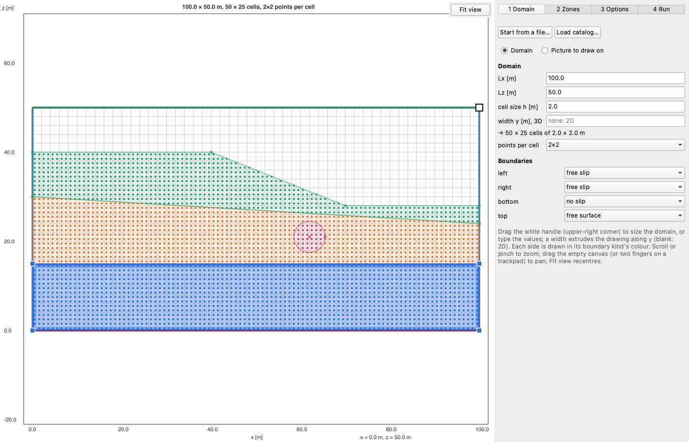
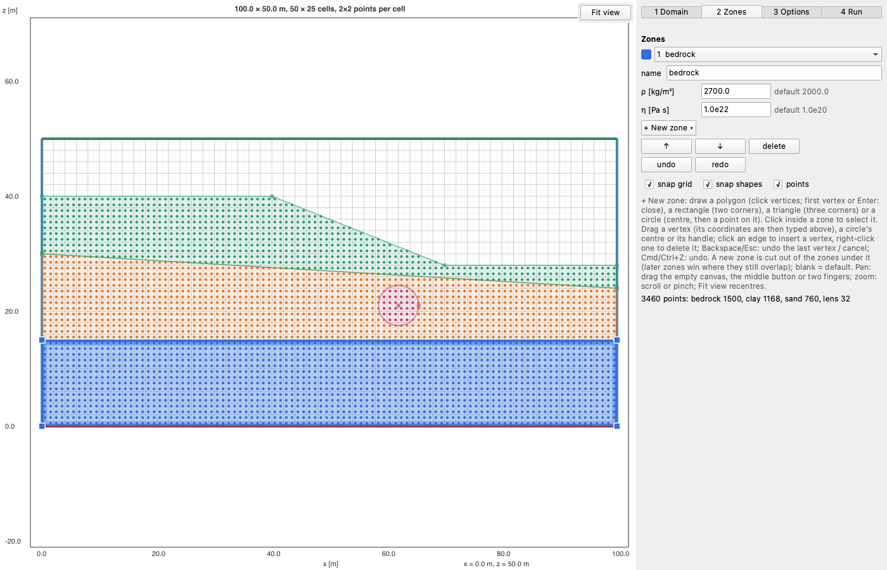
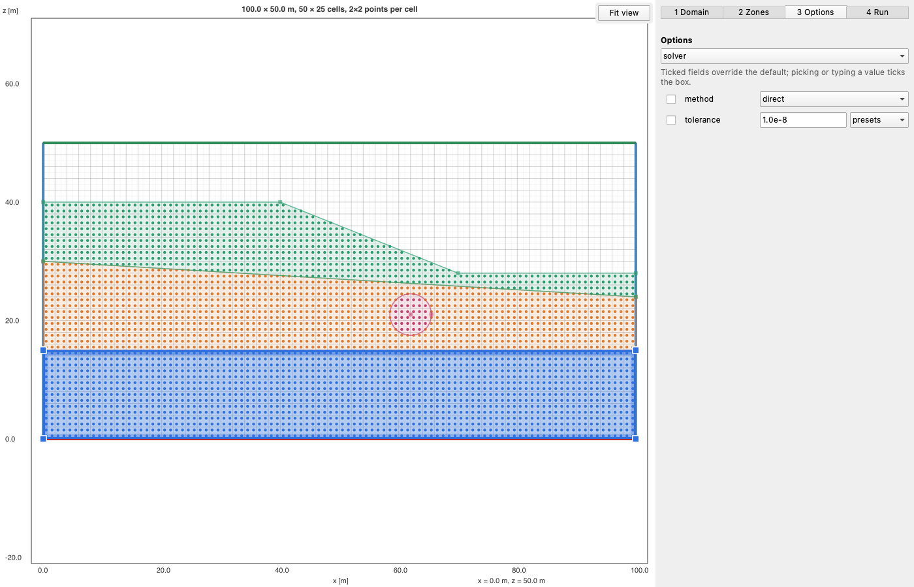
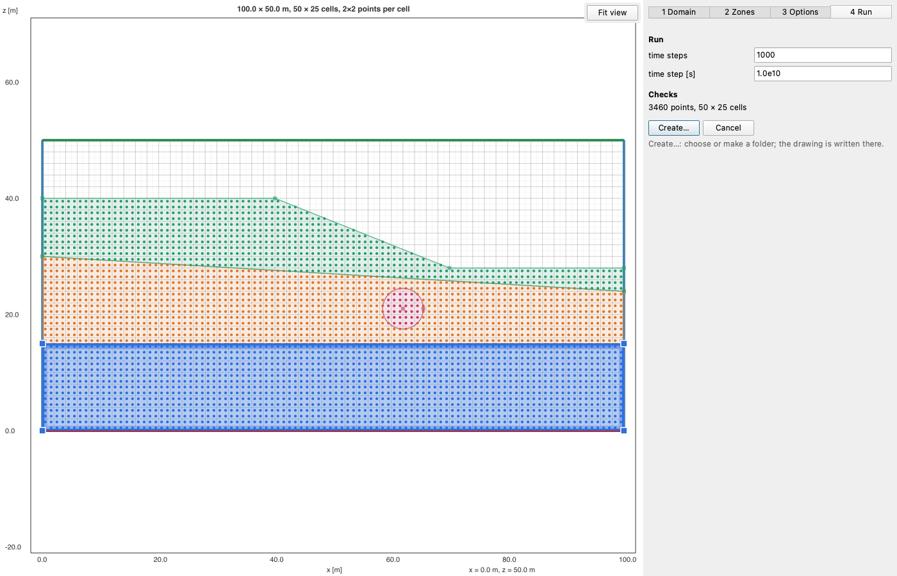

# Drawing in the window

```julia
using EasyDraw
l = draw()                                   # a new domain, on the Domain step
l = draw(l)                                  # edit a layout, on the Zones step
l = draw("model_layout.toml")                # edit a layout file
l = draw(l; catalog="catalog.toml")          # with what your program offers (see Catalogs)
```

[`draw`](@ref) opens the window and waits. **Create…** writes the layout into a folder you choose and returns it;
**Cancel**, or closing the window, returns `nothing`. The first window of a session takes about 20 s, while Qt loads;
the next ones open at once.

The window has a canvas on the left and four steps on the right, as tabs: **Domain**, **Zones**, **Options** (only
when the catalog has options) and **Run**. You can go back and forth between them at any time.

The pictures on this page show a slope over two layers, with a lens, drawn with a small catalog: two zone properties
(ρ and η), three boundary kinds, three options and two run settings.

## Domain



- **Size:** drag the white handle at the domain's upper-right corner, or type `Lx`, `Lz` and the cell size `h`. Cells
  are square: the numbers of cells follow from `h`, shown under the fields.
- **Width y, 3D:** a width extrudes the drawing along y; leave it blank for 2D.
- **Points per cell:** the canvas previews `ni`×`ni` points per cell, at the centres of the sub-cells: the points
  [`points`](@ref) returns.
- **Boundaries:** a boundary kind per side, from the catalog. Each side is drawn in its kind's colour.
- **Start from a file…** opens a layout file (or your program's own file, see [Catalogs](catalog.md)), replacing what is
  drawn.
- **Load catalog…** replaces the catalog with a catalog file's (see [Catalogs](catalog.md)).

### Picture to draw on

Choose **Picture to draw on** to trace zones over a scanned cross-section or a map, any picture Qt reads:

1. Pick the picture. It opens across the domain's width, under the grid.
2. Set its scale: **Measure a scale bar**, click the bar's two ends on the picture, type its length in metres and
   press Enter (Esc cancels). Or type the picture's width.
3. Place it: its lower-left corner (`x`, `z`, 0 by default; a negative value crops it) and its opacity.

The domain follows the picture, from the origin to the picture's far corner, in whole cells of size `h`; typing `Lx`
or `Lz` afterwards still changes it. Choosing **Domain** again hides the picture and keeps it. The picture is a drawing
aid only: it is not saved with the layout.

## Zones



**+ New zone ▾** draws a new zone:

- **Draw:** a polygon. Click its vertices, then click the first vertex again, or press Enter, to close it.
- **Rectangle:** two opposite corners.
- **Triangle:** three corners; it closes on the third.
- **Circle:** its centre, then a point on it.

A new zone is cut out of the zones it overlaps: their outlines then follow it and share its vertices. Zones written in
code may still overlap; there, the later zone wins, and the earlier one is drawn dashed under it.

**Snapping.** Clicks snap to existing vertices first, then to edges (**snap shapes**), then to the sub-cells' corners,
every `h/ni` (**snap grid**), so a vertex never sits on a point. The cursor shows what it snapped to: a square on a
vertex, a diamond on an edge, a ring on the grid. A vertex placed on another zone's edge is inserted into that edge, so
the two zones share it.

**Editing:**

- Drag a vertex to move it, in every zone that shares it. Its coordinates can then be typed exactly in the **vertex**
  row; **×** deletes it.
- Click an edge to insert a vertex there; right-click a vertex to delete it.
- Drag a circle's centre or its handle, or type its centre and radius in the **circle** row.
- Click inside a zone to select it, or pick it in the list.

**The selected zone:** its **name** and its properties, from the catalog. A blank property takes the default shown
beside it. **↑** and **↓** move the zone in the list: a zone lower in the list wins where zones overlap. **delete**
removes it; **undo** and **redo** undo and redo any edit. **points** shows or hides the points; the line under the help
text counts them per zone.

**Keys:**

| Key                                   | While drawing a zone        | Otherwise   |
|:--------------------------------------|:----------------------------|:------------|
| Enter                                 | close the polygon           |             |
| Backspace                             | remove the last vertex      |             |
| Esc                                   | cancel the zone             |             |
| Cmd/Ctrl + Z                          | remove the last vertex      | undo        |
| Shift + Cmd/Ctrl + Z, or Cmd/Ctrl + Y |                             | redo        |

## Moving around

These work on every step:

- **Zoom:** the mouse wheel, a trackpad pinch, or Cmd/Ctrl + scroll, about the pointer.
- **Pan:** drag the empty canvas, drag with the middle button (also while drawing), or move two fingers on a
  trackpad.
- **Fit view** (upper-right corner of the canvas) recentres on the domain.

## Options



The catalog's options, on pages by the first part of their keys (`solver.method` is on page `solver`), picked in the
drop-down at the top. An option is
used only when its box is ticked: picking or typing a value ticks it, and unticking it restores the default. A number
can be typed, or picked from its **presets**; a list option is a grid of check boxes.

The ticked options are in the layout's `options`, nested by the parts of their keys:

```julia
l.options["solver"]["method"]                               # set only when ticked
get(get(l.options, "solver", Dict()), "method", "direct")   # with the default
```

## Run



The catalog's run settings, then the **Checks**: what your program reports on the layout, by default the number of
points and the zones that reach outside the domain or hold no point. An error blocks **Create…**; a warning needs a
second click on it.

**Create…** asks for a folder (choose one, or make one with the dialog's New Folder button) and writes the layout
there, by default as `<folder name>_layout.toml`. The window closes and `draw` returns the layout, whose `folder` is
that folder. **Cancel** closes the window and returns `nothing`.

The run settings are in the layout's `run`:

```julia
l.run["nt"]
```
